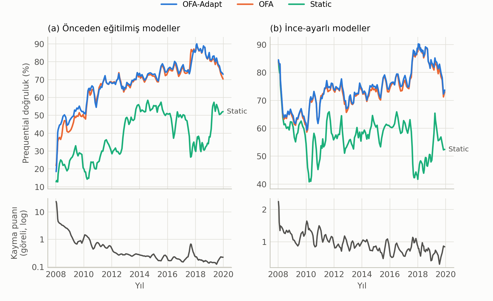

# LLM-OFA-TR: On-the-Fly Adaptation of Turkish Language Models on a 23-Year News Stream

This repository is the Turkish counterpart of [LLM-OFA](https://github.com/PouyaGhahramanian/LLM-OFA)
(CIKM 2025). It provides

* **THD-Temporal**, a cleaned, chronologically ordered stream of **78,171 Turkish news articles (Milliyet.com,
  1997–2019, 10 categories)** built from the *Türkçe Haber Derlemi* of **Ömer Gözüaçık**, and
* a reference implementation of **online (stream) text classification with Turkish transformer encoders**: the model
  predicts each incoming batch, receives the true labels, and is updated on the fly (OFA), optionally with
  **Adaptimizer**, our fast/slow-weight optimizer for temporal drift.

It is meant as a starting point for anyone working on **Turkish online / continual text classification under concept
drift**.

## Dataset: THD-Temporal

> **Credit.** THD-Temporal is derived from the **Turkish News Corpus (Türkçe Haber Derlemi)** collected and openly
> shared by **Ömer Gözüaçık** (Açık Kaynak Hackathon Programı 2020):
> <https://github.com/ogozuacik/turkce-haber-derlemi>, MIT License, © 2020 Ömer Gözüaçık.
> The article selection and the original labels are his work; please cite the original corpus when using the data.

`scripts/prepare_thd_temporal.py` rebuilds the dataset from the two original files (downloaded automatically):

| Step | Detail |
|---|---|
| Article selection, labels | unchanged from `filtrelenmis_temizlenmis_derlem.csv.gz` (81,407 articles, 12 categories) |
| Original text | title / summary / body restored from the raw scrape `milliyet_derlem.csv.gz` (joined on `link`, 100% match); the filtered file is lower-cased without digits and punctuation |
| Dates | day/month swap in the filtered file repaired for 29,427 articles (dates re-parsed from raw `dd.mm.yyyy`) |
| Labels | 10 classes: `Ege` (regional edition), `Pazar`, `Cumartesi` (weekend supplements) merged into `Diğer` |
| Exclusions (flagged) | 19 invalid dates (1899); 2,247 articles whose only date is the June/July 2020 crawl date (93% sports, mostly from the Skorer site; article ids indicate publication in roughly 2009–2019, exact dates unknown); 970 exact duplicates |
| Split | `finetune` 1997–2007 (45,384) · `stream` 2008–2019 (32,787) |

| label | finetune (1997–2007) | stream (2008–2019) |
|---|---:|---:|
| Gündem | 9,502 | 11,515 |
| Siyaset | 9,325 | 5,193 |
| Ekonomi | 8,701 | 2,456 |
| Diğer | 6,010 | 2,601 |
| Spor | 6,335 | 2,213 |
| Dünya | 2,971 | 1,814 |
| Magazin | 1,001 | 2,779 |
| Teknoloji-Bilim | 54 | 3,042 |
| Yaşam | 770 | 832 |
| Kültür-Sanat | 715 | 342 |

The stream drifts strongly: `Teknoloji-Bilim` is practically absent before 2008 and makes up 33–42% of all articles
in 2017–2018, the shares of `Ekonomi` and `Dünya` shrink and `Gündem` grows (`figures/label_drift.png`), and the
vocabulary of each class changes over time (`figures/wordclouds_ekonomi.png`). (The lower `Spor` share after 2010 is
partly caused by excluding the crawl-dated sports articles above.) The input also changes: the summary repeats the
title for 30% of the `finetune` items but for only 0.2% of the `stream` items.

**Load it** in one line:

```python
from datasets import load_dataset
ds = load_dataset("p0uy4/thd-temporal")   # splits: finetune (1997-2007), stream (2008-2019)
```

```python
import kagglehub, pandas as pd
df = pd.read_parquet(kagglehub.dataset_download("pooyagh/thd-temporal") + "/thd_temporal.parquet")
```

or rebuild it from the original corpus (downloaded automatically):

```bash
python scripts/prepare_thd_temporal.py --orig-dir data/original --out-dir data
```

`load_dataset("p0uy4/thd-temporal", "full")` returns all 81,407 source articles with the exclusion flags.

## Method and protocol

Protocol as described in the LLM-OFA paper (CIKM 2025), with the prequential window adapted to the 12.5× shorter stream:

* **Settings.** *pretrained*: the Hugging Face checkpoint with a new classification head; the whole model is lightly
  calibrated with one pass over a random 1% of the stream (328 items; AdamW, lr 2e-5, batch size = model batch size / 4),
  and these items are then removed from the stream; the same calibrated model is the starting point of Static, OFA and
  OFA-Adapt. *fine-tuned*: trained on 1997–2007 (90/10 split, 3 epochs, lr 5e-5, best epoch by validation loss).
* **Configurations.** *Static* (no updates) · *OFA* (test-then-train, AdamW, lr 2e-5) · *OFA-Adapt* (test-then-train
  with Adaptimizer: lr 2e-5, squared-gradient window w = 10, slow-weight EMA rate ρ = 0.1; predictions with the slow
  weights; drift score = cosine distance between fast and slow weights; slow weights re-synchronised when the drift
  score exceeds twice its running mean).
* **Input.** `title + ". " + summary`, max 160 sub-word tokens (truncates <1% of the inputs); the summary is dropped
  when it repeats the title, and the `". "` becomes a single space when the title already ends in `. ! ? … : ; " '`.
* **Metrics.** accuracy and macro-F1 over the whole stream; worst-case accuracy = minimum prequential accuracy over a
  sliding window of the last 2,000 items (the paper's window); the curves in the figures use consecutive 200-item
  windows (~164 points) because the Turkish stream (32,787 items) is 12.5× shorter than the English one.

| family | Turkish checkpoint | batch size |
|---|---|---:|
| BERT | [`dbmdz/bert-base-turkish-cased`](https://huggingface.co/dbmdz/bert-base-turkish-cased) (BERTurk) | 32 |
| DistilBERT | [`dbmdz/distilbert-base-turkish-cased`](https://huggingface.co/dbmdz/distilbert-base-turkish-cased) | 64 |
| ELECTRA | [`dbmdz/electra-base-turkish-cased-discriminator`](https://huggingface.co/dbmdz/electra-base-turkish-cased-discriminator) | 16 |
| ALBERT | [`loodos/albert-base-turkish-uncased`](https://huggingface.co/loodos/albert-base-turkish-uncased) | 16 |
| RoBERTa | [`TURKCELL/roberta-base-turkish-uncased`](https://huggingface.co/TURKCELL/roberta-base-turkish-uncased) | 32 |
| DeBERTa | [`microsoft/mdeberta-v3-base`](https://huggingface.co/microsoft/mdeberta-v3-base) (multilingual; no Turkish DeBERTa exists) | 8 |

Uncased checkpoints receive Turkish-aware lower-casing (`I → ı`, `İ → i`): the ALBERT tokenizer's own lower-casing
maps `İ` to `i` + `<unk>` and `I` to `i`, and the TURKCELL RoBERTa tokenizer (byte-level BPE) does no lower-casing at
all although its vocabulary was learned from lower-cased text.

## Results

All numbers are computed over the full 2008–2019 stream (32,787 items; 32,459 in the pretrained setting after
removing the calibration sample) with the English hyper-parameters unchanged. Per-run metrics, predictions and the
aggregated tables are in `results/`.

**Accuracy (%)** — columns: pretrained (Static, OFA, OFA-Adapt) | fine-tuned (Static, OFA, OFA-Adapt)

| Model | Static | OFA | OFA-Adapt | Static | OFA | OFA-Adapt |
|---|---:|---:|---:|---:|---:|---:|
| ALBERT | 44.47 | 70.85 | **72.38** | 55.17 | 73.71 | **74.65** |
| BERT | 35.10 | 70.82 | **74.30** | 63.73 | 77.03 | **77.58** |
| DeBERTa | 35.10 | 68.10 | **70.60** | 52.44 | 74.83 | **76.03** |
| DistilBERT | 35.09 | **61.46** | 59.17 | 54.74 | 73.00 | **73.31** |
| ELECTRA | 35.10 | 69.36 | **69.76** | 51.99 | 75.62 | **76.34** |
| RoBERTa | 35.11 | **68.01** | 67.88 | 57.92 | **74.22** | 74.18 |
| *Mean* | 36.66 | 68.10 | **69.02** | 56.00 | 74.73 | **75.35** |

**Macro-F1 (%)** — columns: pretrained (Static, OFA, OFA-Adapt) | fine-tuned (Static, OFA, OFA-Adapt)

| Model | Static | OFA | OFA-Adapt | Static | OFA | OFA-Adapt |
|---|---:|---:|---:|---:|---:|---:|
| ALBERT | 17.18 | 60.25 | **61.33** | 46.61 | 65.94 | **66.59** |
| BERT | 5.20 | 58.41 | **64.15** | 54.75 | 70.04 | **70.64** |
| DeBERTa | 5.20 | 56.16 | **58.92** | 41.89 | 67.70 | **69.04** |
| DistilBERT | 5.23 | **45.26** | 41.80 | 43.19 | 63.76 | **64.23** |
| ELECTRA | 5.20 | 56.26 | **56.94** | 41.28 | 68.31 | **69.12** |
| RoBERTa | 5.21 | **53.21** | 52.91 | 47.78 | **65.46** | 65.17 |
| *Mean* | 7.20 | 54.92 | **56.01** | 45.92 | 66.87 | **67.46** |



*Top: mean prequential accuracy of the six models (consecutive 200-item windows, 3-window moving average).
Bottom: Adaptimizer's drift score (cosine distance between fast and slow weights, relative to each model's mean,
log scale).*

**Key observations**

* **Strong natural drift.** Fine-tuned Static models reach 72.2% accuracy on held-out 1997–2007 data but only 56.0%
  on the 2008–2019 stream, falling to 47–51% in 2017–2018 when `Teknoloji-Bilim` surges (Static F1 on that class: 36%).
* **Online adaptation is essential.** OFA raises the accuracy of fine-tuned models by +18.7 points (macro-F1 +21.0)
  and learns the emerging class (`Teknoloji-Bilim` F1 ≈ 95%); on the English 1M-News stream the same gain was +0.65.
* **Adaptimizer adds a consistent margin with unchanged hyper-parameters:** +0.62 accuracy / +0.59 macro-F1 over
  AdamW for fine-tuned models (5 of 6 models) and +0.92 / +1.08 for pretrained models (4 of 6). Averaged over the
  models it is ahead of AdamW in every year of the stream (fine-tuned) and adapts faster at the start of the stream
  (pretrained, 2008: 40.4% vs 36.6%). Worst-case accuracy (2,000-item sliding window): +0.52 (fine-tuned, 3 of 6)
  and +3.89 (pretrained, 5 of 6).
* **Caveat (pretrained setting).** The 1% calibration sample is only 328 items here (4,113 in English), so 5 of the 6
  pretrained Static models predict the majority class (`Gündem`, 35.1% of the stream); gains over Static in that
  setting mostly reflect learning from the stream itself.

**English (1M-News) vs Turkish (THD-Temporal)** — mean over the six models, absolute points:

| Setting | Metric | OFA − Static (EN) | OFA − Static (TR) | OFA-Adapt − OFA (EN) | OFA-Adapt − OFA (TR) |
|---|---|---:|---:|---:|---:|
| fine-tuned | accuracy | +0.65 | +18.73 | +0.29 | +0.62 |
| fine-tuned | macro-F1 | +0.93 | +20.95 | +0.28 | +0.59 |
| pretrained | accuracy | +14.26 | +31.44 | +0.75 | +0.92 |
| pretrained | macro-F1 | +22.77 | +47.72 | +0.80 | +1.08 |

English values are copied from LLM-OFA (CIKM 2025) Table 2. In the released English runs the pretrained OFA/OFA-Adapt
models started from an uncalibrated head on the full stream and the pretrained Static model was scored without the
first 4,113 stream items; the Turkish runs follow the protocol as described in the paper.

## Reproduce

```bash
pip install -r requirements.txt          # torch >= 2.6 (needed to load the .bin checkpoints safely)
python scripts/prepare_thd_temporal.py --orig-dir data/original --out-dir data
python scripts/run_all.py --gpus 0 1      # 6 fine-tuning jobs + 36 stream runs, resumable
python scripts/aggregate.py               # tables -> results/
python scripts/plot_stream.py             # figures/stream_accuracy_drift.png
python scripts/plot_dataset.py            # figures/label_drift.png, figures/wordclouds_*.png
```

Single runs:

```bash
python scripts/finetune.py --model bert
python scripts/stream.py --model bert --setting finetuned --config ofa-adapt
python scripts/stream.py --model bert --setting pretrained --config static
```

Each run writes `results/stream/<setting>_<model>_<config>/` with `metrics.json`, `predictions.csv.gz`
(per-item predictions, usable for significance tests), `drift.csv.gz` (OFA-Adapt), `window_accuracy.txt` and a
classification report.

## Repository layout

```
src/ofa_tr/      data loading, Turkish model registry, Adaptimizer, plotting style
scripts/         dataset build, fine-tuning, stream evaluation, job runner, tables, figures, hub export
results/         per-run metrics and predictions, aggregated tables
figures/         figures used in the paper/report
hub/             dataset card used for the Hugging Face / Kaggle releases
```

## Availability

* **Dataset (Hugging Face):** <https://huggingface.co/datasets/p0uy4/thd-temporal>
* **Dataset (Kaggle):** <https://www.kaggle.com/datasets/pooyagh/thd-temporal>
* **Code, predictions and result tables:** this repository
* **Original corpus:** <https://github.com/ogozuacik/turkce-haber-derlemi> (Ömer Gözüaçık, MIT)

## Citation

```bibtex
@inproceedings{ghahramanian2025ofa,
  author    = {Pouya Ghahramanian and Sepehr Bakhshi and Fazli Can},
  title     = {LLM-OFA: On-the-Fly Adaptation of Large Language Models to Address Temporal Drift Across Two Decades of News},
  booktitle = {Proceedings of the 34th ACM International Conference on Information and Knowledge Management (CIKM '25)},
  year      = {2025},
  doi       = {10.1145/3746252.3760846}
}
@misc{gozuacik2020turkcehaberderlemi,
  author       = {G{\"o}z{\"u}a{\c{c}}{\i}k, {\"O}mer},
  title        = {T{\"u}rk{\c{c}}e Haber Derlemi ve Haberlerin Kategorik S{\i}n{\i}fland{\i}r{\i}lmas{\i}},
  year         = {2020},
  howpublished = {\url{https://github.com/ogozuacik/turkce-haber-derlemi}}
}
```

## Acknowledgements

This work is supported by TÜBİTAK (The Scientific and Technological Research Council of Türkiye) under grant
no. 125E060. We thank Ömer Gözüaçık for collecting and openly sharing the Turkish News Corpus.

## License

Code: MIT (see `LICENSE`). Data: derived from the MIT-licensed Turkish News Corpus (see `data/LICENSE-THD.txt`);
article texts were originally published on Milliyet.com and are redistributed, as in the original corpus, for research.

## Türkçe özet

Bu depo, CIKM 2025'te yayımlanan LLM-OFA çalışmamızın Türkçe karşılığıdır. Ömer Gözüaçık'ın derleyip açık kaynak
olarak paylaştığı Türkçe Haber Derlemi'nden (Milliyet.com, 1997–2019) türettiğimiz **THD-Temporal** veri kümesini ve
Türkçe dil modellerinin (BERTurk, DistilBERTurk, ELECTRA, ALBERT, RoBERTa, mDeBERTa) zaman içinde değişen haber
akışında çevrimiçi olarak (on-the-fly) uyarlanmasına yönelik kodları içermektedir. Akıştaki her haber grubu önce
sınıflandırılmakta, ardından gerçek etiketleriyle model güncellenmektedir (OFA); Adaptimizer ise hızlı/yavaş ağırlık
mekanizmasıyla kayma anlarında hızlı ve kararlı uyum sağlamaktadır. TÜBİTAK 125E060 numaralı proje kapsamında
geliştirilmiştir.
